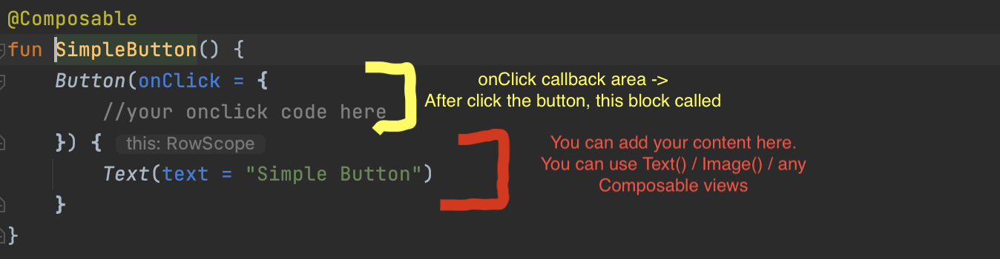
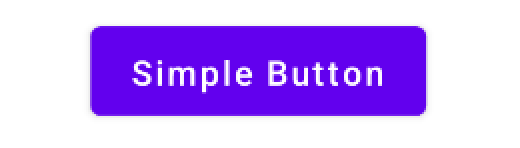
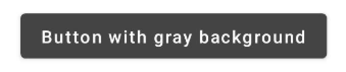
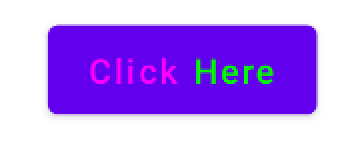
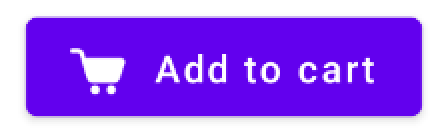
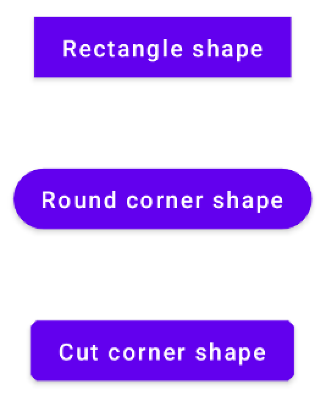
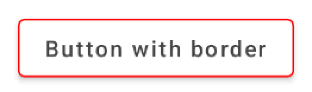
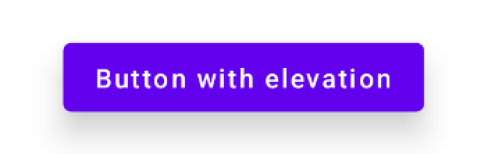

# Botones (Buttons) en Jetpack Compose

> Aprende a crear distintos tipos de botones en Jetpack Compose: simples, de color, con iconos, con formas, con bordes y con elevación.

*Básicos · 5 de febrero de 2024 · 8 min de lectura*  
*Fuente (en inglés): <https://www.jetpackcompose.net/buttons-in-jetpack-compose>*

En los botones de Jetpack Compose debes proporcionar dos argumentos: el callback `onClick`, que se ejecuta al pulsar el botón, y el contenido del botón, que es una lambda composable. Puedes añadir un composable `Text` o cualquier otro composable (iconos, imágenes...) como elementos hijos del `Button`.



> **Nota sobre Material 3 y los imports:** los ejemplos de este documento usan Material 3 (`androidx.compose.material3.Button`, `ButtonDefaults`, etc.), que es lo que usan por defecto los proyectos nuevos de Android Studio. Si tu proyecto usa Material 2 (`androidx.compose.material`), algunos nombres cambian: `containerColor` es `backgroundColor` y `ButtonDefaults.buttonElevation()` es `ButtonDefaults.elevation()`. Los demás imports (`Color`, `dp`, `RoundedCornerShape`, `BorderStroke`...) los sugiere Android Studio con `Alt + Enter`.

---

## Parámetros de la función Button

A continuación se muestran los parámetros de la firma de `Button` (versión de Material 3), con una breve explicación de cada uno:

```kotlin
Button(
    onClick = { },                                   // Callback que se ejecuta al pulsar el botón (obligatorio).
    modifier = Modifier,                             // Modificador para aplicar tamaño, márgenes, fondos o comportamientos.
    enabled = true,                                  // Si es false, el botón se ve atenuado y no responde a pulsaciones.
    shape = ButtonDefaults.shape,                    // Forma del botón (por defecto, esquinas totalmente redondeadas).
    colors = ButtonDefaults.buttonColors(),          // Colores de fondo (containerColor) y contenido (contentColor).
    elevation = ButtonDefaults.buttonElevation(),    // Elevación (sombra) según el estado: normal, pulsado, deshabilitado...
    border = null,                                   // Borde del botón, por ejemplo BorderStroke(1.dp, Color.Red).
    contentPadding = ButtonDefaults.ContentPadding,  // Espacio interno entre el borde del botón y su contenido.
    interactionSource = null,                        // Permite observar estados de interacción (pulsado, enfocado...).
    content = { }                                    // Contenido del botón (Text, Icon...). Se coloca en horizontal (RowScope).
)
```

Además de `Button` (relleno), Material 3 ofrece otras variantes con los mismos parámetros: `OutlinedButton` (solo borde), `TextButton` (sin fondo ni borde), `ElevatedButton` (con sombra) y `FilledTonalButton` (relleno suave).

---

## 1. Botón simple

```kotlin
@Composable
fun SimpleButton() {
    Button(onClick = {
        // Tu código al pulsar el botón
    }) {
        Text(text = "Simple Button")
    }
}
```



## 2. Botón con color personalizado

El color de fondo se define con `containerColor` y el del contenido (texto e iconos) con `contentColor`, ambos dentro de `ButtonDefaults.buttonColors()`.

```kotlin
@Composable
fun ButtonWithColor() {
    Button(
        onClick = {
            // Tu código al pulsar el botón
        },
        colors = ButtonDefaults.buttonColors(
            containerColor = Color.DarkGray,
            contentColor = Color.White
        )
    ) {
        Text(text = "Button with gray background")
    }
}
```



## 3. Botón con varios textos

El contenido del botón es un `RowScope`, así que los hijos se colocan uno al lado del otro en horizontal.

```kotlin
@Composable
fun ButtonWithTwoTextView() {
    Button(onClick = {
        // Tu código al pulsar el botón
    }) {
        Text(text = "Click ", color = Color.Magenta)
        Text(text = "Here", color = Color.Green)
    }
}
```



## 4. Botón con icono

Se recomienda `Icon` frente a `Image`, porque `Icon` se tiñe automáticamente con el `contentColor` del botón. Si tu imagen es a todo color (por ejemplo un PNG), usa `Image` para que no se tiña. Como el texto del botón ya describe la acción, el icono es decorativo y su `contentDescription` puede ser `null`.

```kotlin
@Composable
fun ButtonWithIcon() {
    Button(onClick = { }) {
        Icon(
            painter = painterResource(id = R.drawable.ic_cart),
            contentDescription = null, // Decorativo: el texto ya describe la acción
            modifier = Modifier.size(20.dp)
        )
        Text(text = "Add to cart", modifier = Modifier.padding(start = 10.dp))
    }
}
```

> **Nota:** `R.drawable.ic_cart` es un recurso de tu proyecto, así que debe existir en `res/drawable`. Como alternativa sin recursos propios puedes usar un icono incluido en Compose: `Icon(imageVector = Icons.Default.ShoppingCart, contentDescription = null)`.



## 5. Botones con formas

En Material 3 la forma por defecto del botón es totalmente redondeada (tipo píldora). Con el parámetro `shape` puedes cambiarla.

**Forma rectangular (Rectangle Shape):**

```kotlin
@Composable
fun ButtonWithRectangleShape() {
    Button(onClick = {}, shape = RectangleShape) {
        Text(text = "Rectangle shape")
    }
}
```

**Esquinas redondeadas (Round Corner Shape):**

```kotlin
@Composable
fun ButtonWithRoundCornerShape() {
    Button(onClick = {}, shape = RoundedCornerShape(20.dp)) {
        Text(text = "Round corner shape")
    }
}
```

**Esquinas cortadas (Cut Corner Shape):**

```kotlin
@Composable
fun ButtonWithCutCornerShape() {
    // CutCornerShape(percent: Int): el valor se interpreta como porcentaje
    // CutCornerShape(size: Dp): también puedes pasar un valor en dp
    Button(onClick = {}, shape = CutCornerShape(10)) {
        Text(text = "Cut corner shape")
    }
}
```



## 6. Botón con borde

Para un botón con borde lo habitual es usar `OutlinedButton`, que ya viene con fondo transparente. El borde se personaliza con el parámetro `border`. (`Button` también acepta `border`, pero conserva su fondo relleno.)

```kotlin
@Composable
fun ButtonWithBorder() {
    OutlinedButton(
        onClick = {
            // Tu código al pulsar el botón
        },
        border = BorderStroke(1.dp, Color.Red)
    ) {
        Text(text = "Button with border", color = Color.DarkGray)
    }
}
```



## 7. Elevación del botón

En Material 3 el `Button` normal tiene elevación `0.dp` por defecto; para cambiarla se usa `ButtonDefaults.buttonElevation()`. Si quieres un botón con sombra de serie, existe `ElevatedButton`.

```kotlin
@Composable
fun ButtonWithElevation() {
    Button(
        onClick = {
            // Tu código al pulsar el botón
        },
        elevation = ButtonDefaults.buttonElevation(
            defaultElevation = 10.dp,
            pressedElevation = 15.dp,
            disabledElevation = 0.dp
        )
    ) {
        Text(text = "Button with elevation")
    }
}
```



---

## Documentación oficial y código fuente

*   Documentación oficial: <https://developer.android.com/develop/ui/compose/components/button>
*   Código fuente de los ejemplos: <https://github.com/rranjithkumar100/Jetpack-Compose-Samples>
