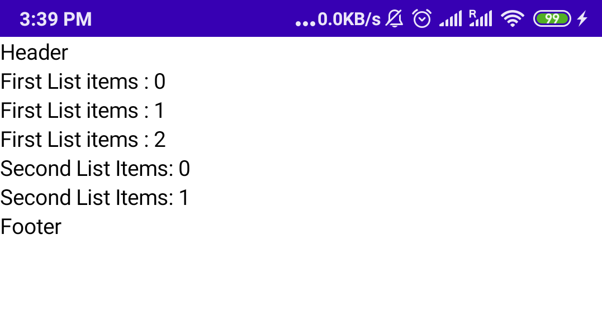
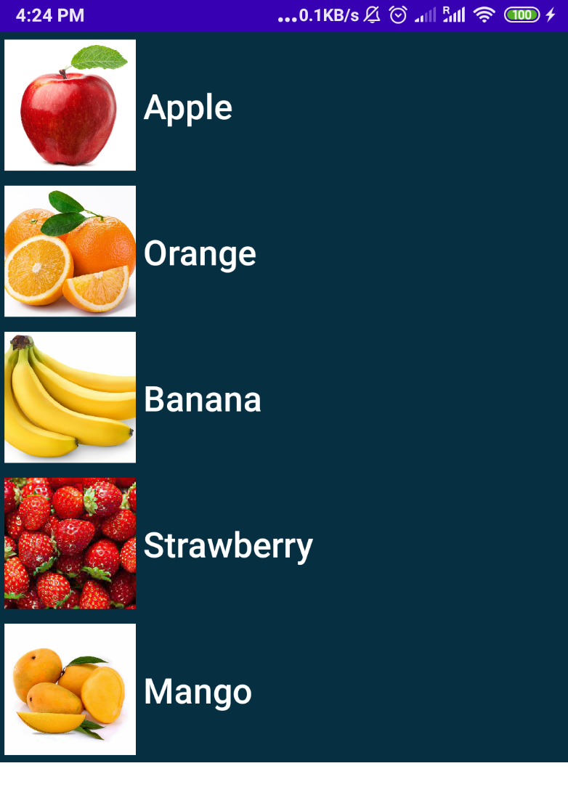

# LazyColumn y LazyRow (Material 3)

> Aprende a crear listas con desplazamiento eficientes en Jetpack Compose con LazyColumn y LazyRow, usando componentes de Material 3.

*Básicos · 12 de febrero de 2024 · 8 min de lectura*  
*Fuente (en inglés): <https://www.jetpackcompose.net/lazycolumn-and-lazyrow>*

> **Sobre las librerías:** `LazyColumn` y `LazyRow` pertenecen a Compose Foundation (`androidx.compose.foundation.lazy`) y son independientes de Material. Los ejemplos de este artículo usan además componentes de **Material 3** (`androidx.compose.material3`), como `Text`.

## Composables Lazy

Si necesitas mostrar un gran número de elementos (o una lista de longitud desconocida), usar un layout como `Column` puede causar problemas de rendimiento, ya que se compondrán y se colocarán todos los elementos, sean visibles o no.

Compose ofrece un conjunto de componentes que solo componen y colocan los elementos visibles en el viewport del componente. Entre ellos están `LazyColumn` y `LazyRow`.

**LazyColumn**: genera una lista con desplazamiento vertical.  
**LazyRow**: genera una lista con desplazamiento horizontal.

> *Para desarrolladores de Android (Views):* **LazyColumn** equivale a un RecyclerView vertical y **LazyRow** a un RecyclerView horizontal. La equivalencia es de uso, no de funcionamiento interno: no hay `Adapter` ni `ViewHolder`, y describes el contenido de cada elemento directamente con composables.

## API de LazyColumn

Estos son los argumentos de la función `LazyColumn`:

```kotlin
@Composable
fun LazyColumn(
    modifier: Modifier = Modifier,                          // Modificadores de tamaño, padding, fondo, etc.
    state: LazyListState = rememberLazyListState(),         // Controla y observa el estado de la lista (posición del scroll)
    contentPadding: PaddingValues = PaddingValues(0.dp),    // Relleno alrededor de todo el contenido de la lista
    reverseLayout: Boolean = false,                         // Invierte el sentido del scroll y de la colocación de los elementos
    verticalArrangement: Arrangement.Vertical =
        if (!reverseLayout) Arrangement.Top else Arrangement.Bottom, // Cómo se colocan y separan los elementos en vertical
    horizontalAlignment: Alignment.Horizontal = Alignment.Start,    // Alineación horizontal de los elementos
    flingBehavior: FlingBehavior = ScrollableDefaults.flingBehavior(), // Comportamiento del gesto de "lanzar" la lista (fling)
    userScrollEnabled: Boolean = true,                      // Si es false, el usuario no puede hacer scroll (por código con state sí)
    overscrollEffect: OverscrollEffect? = rememberOverscrollEffect(),  // Efecto visual al llegar al final de la lista (null lo desactiva)
    content: LazyListScope.() -> Unit                       // Define los elementos de la lista con item(), items()...
)
```

> El parámetro `overscrollEffect` solo existe en versiones recientes de Compose Foundation. Si tu versión no lo tiene, ignóralo.

## API de LazyRow

`LazyRow` tiene los mismos parámetros, cambiando los de disposición y alineación para el eje horizontal:

```kotlin
@Composable
fun LazyRow(
    modifier: Modifier = Modifier,                          // Modificadores de tamaño, padding, fondo, etc.
    state: LazyListState = rememberLazyListState(),         // Controla y observa el estado de la lista (posición del scroll)
    contentPadding: PaddingValues = PaddingValues(0.dp),    // Relleno alrededor de todo el contenido de la lista
    reverseLayout: Boolean = false,                         // Invierte el sentido del scroll y de la colocación de los elementos
    horizontalArrangement: Arrangement.Horizontal =
        if (!reverseLayout) Arrangement.Start else Arrangement.End, // Cómo se colocan y separan los elementos en horizontal
    verticalAlignment: Alignment.Vertical = Alignment.Top,  // Alineación vertical de los elementos
    flingBehavior: FlingBehavior = ScrollableDefaults.flingBehavior(), // Comportamiento del gesto de "lanzar" la lista (fling)
    userScrollEnabled: Boolean = true,                      // Si es false, el usuario no puede hacer scroll (por código con state sí)
    overscrollEffect: OverscrollEffect? = rememberOverscrollEffect(),  // Efecto visual al llegar al final de la lista (null lo desactiva)
    content: LazyListScope.() -> Unit                       // Define los elementos de la lista con item(), items()...
)
```

## API de LazyListScope: item, items, itemsIndexed y stickyHeader

El parámetro `content` de `LazyColumn` y `LazyRow` es un bloque `LazyListScope.() -> Unit`. Dentro de él se añaden los elementos con estas funciones:

```kotlin
// Un único elemento
fun item(
    key: Any? = null,                                       // Clave estable y única del elemento (mantiene el scroll si cambia la lista)
    contentType: Any? = null,                               // Tipo de contenido; los elementos del mismo tipo se reutilizan mejor
    content: @Composable LazyItemScope.() -> Unit           // Composable que dibuja el elemento
)

// Varios elementos a partir de un número
fun items(
    count: Int,                                             // Número de elementos
    key: ((index: Int) -> Any)? = null,                     // Clave estable y única para cada posición
    contentType: (index: Int) -> Any? = { null },           // Tipo de contenido para cada posición
    itemContent: @Composable LazyItemScope.(index: Int) -> Unit // Composable que dibuja cada elemento
)

// Varios elementos a partir de una lista (requiere import androidx.compose.foundation.lazy.items)
inline fun <T> LazyListScope.items(
    items: List<T>,                                         // Lista de datos a mostrar
    noinline key: ((item: T) -> Any)? = null,               // Clave estable y única para cada dato
    noinline contentType: (item: T) -> Any? = { null },     // Tipo de contenido para cada dato
    crossinline itemContent: @Composable LazyItemScope.(item: T) -> Unit // Composable que dibuja cada elemento
)

// Igual que items(), pero también recibe el índice (requiere import androidx.compose.foundation.lazy.itemsIndexed)
inline fun <T> LazyListScope.itemsIndexed(
    items: List<T>,                                         // Lista de datos a mostrar
    noinline key: ((index: Int, item: T) -> Any)? = null,   // Clave estable y única para cada dato
    noinline contentType: (index: Int, item: T) -> Any? = { _, _ -> null }, // Tipo de contenido para cada dato
    crossinline itemContent: @Composable LazyItemScope.(index: Int, item: T) -> Unit // Composable con índice y dato
)

// Cabecera que se queda fija arriba mientras haces scroll
fun stickyHeader(
    key: Any? = null,                                       // Clave estable y única de la cabecera
    contentType: Any? = null,                               // Tipo de contenido de la cabecera
    content: @Composable LazyItemScope.(index: Int) -> Unit // Composable que dibuja la cabecera
)
```

> **Imports:** `items` e `itemsIndexed` para listas son funciones de extensión, así que necesitas importarlas: `androidx.compose.foundation.lazy.items` y `androidx.compose.foundation.lazy.itemsIndexed`. Si no, el compilador no encontrará `items(lista)`.
>
> `stickyHeader` puede requerir `@OptIn(ExperimentalFoundationApi::class)` según la versión de Compose que uses.

## LazyColumn

En `LazyColumn` puedes añadir `item()` o `items()`. Para un único composable usa `item()`. Para una lista de composables usa `items(count: Int)` o `items(items: List<T>)`.

```kotlin
@Composable
fun ListListScopeSample() {
    LazyColumn {
        // Add a single item
        item {
            Text(text = "Header")
        }

        // Add 3 items
        items(3) { index ->
            Text(text = "First List items : $index")
        }

        // Add 2 items
        items(2) { index ->
            Text(text = "Second List Items: $index")
        }

        // Add another single item
        item {
            Text(text = "Footer")
        }
    }
}
```

**Resultado:**



## 1. Lista simple

```kotlin
private val countryList =
    listOf("India", "Pakistan", "China", "United States")

private val listModifier = Modifier
    .fillMaxSize()
    .background(Color.Gray)
    .padding(10.dp)

private val textStyle = TextStyle(fontSize = 20.sp, color = Color.White)

@Composable
fun SimpleListView() {
    LazyColumn(modifier = listModifier) {
        items(countryList) { country ->
            Text(text = country, style = textStyle)
        }
    }
}
```

En este ejemplo usamos una lista de países y la recorremos con `items(items: List<T>)`. Recuerda importar `androidx.compose.foundation.lazy.items`.

## 2. Lista personalizada

Vamos a mostrar una lista de nombres de frutas con su imagen.

**Paso 1: crear una data class**

```kotlin
data class FruitModel(val name: String, @DrawableRes val image: Int)
```

**Paso 2: crear una fila personalizada (función Composable)**

```kotlin
@Composable
fun ListRow(model: FruitModel) {
    Row(
        verticalAlignment = Alignment.CenterVertically,
        modifier = Modifier
            .wrapContentHeight()
            .fillMaxWidth()
            .background(Color(0xFF063041))
    ) {
        Image(
            painter = painterResource(id = model.image),
            contentDescription = null,
            contentScale = ContentScale.Crop,
            modifier = Modifier
                .size(100.dp)
                .padding(5.dp)
        )
        Text(
            text = model.name,
            fontSize = 24.sp,
            fontWeight = FontWeight.SemiBold,
            color = Color.White
        )
    }
}
```

- `Color(0xFF063041)`: crea el color a partir de un valor hexadecimal ARGB.
- `contentDescription = null`: la imagen es decorativa porque el nombre de la fruta ya aparece en el `Text` contiguo.

**Paso 3: crear la lista de datos**

```kotlin
private val fruitsList = listOf(
    FruitModel("Apple", R.drawable.apple),
    FruitModel("Orange", R.drawable.orange),
    FruitModel("Banana", R.drawable.banana),
    FruitModel("Strawberry", R.drawable.strawberry),
    FruitModel("Mango", R.drawable.mango)
)
```

**Paso 4: usar LazyColumn para mostrar la lista**

```kotlin
@Composable
fun FruitList() {
    LazyColumn(
        modifier = Modifier
            .fillMaxSize()
            .background(Color.White)
    ) {
        items(fruitsList) { model ->
            ListRow(model = model)
        }
    }
}
```

**Resultado:**



> **Listas que cambian:** una `mutableListOf` normal no avisa a Compose cuando añades o quitas elementos, así que la pantalla no se actualiza. Si la lista va a cambiar, usa `mutableStateListOf` o guarda la lista en un estado (por ejemplo, en un `ViewModel` con `StateFlow`).

## 3. Content Padding (relleno del contenido)

A veces necesitarás añadir padding alrededor de los bordes del contenido. Los componentes lazy permiten pasar un `PaddingValues` al parámetro `contentPadding` para conseguirlo:

```kotlin
LazyColumn(
    contentPadding = PaddingValues(horizontal = 16.dp, vertical = 8.dp),
) {
    // ...
}
```

A diferencia de aplicar `Modifier.padding(...)` a la lista, el `contentPadding` añade espacio alrededor del contenido pero la lista sigue haciendo scroll hasta los bordes del componente, sin recortar los elementos.

## 4. Content Spacing (espaciado entre elementos)

Para añadir espacio entre los elementos puedes usar `Arrangement.spacedBy()`. El siguiente ejemplo añade 4.dp de espacio entre cada elemento:

```kotlin
LazyColumn(
    verticalArrangement = Arrangement.spacedBy(4.dp),
) {
    // ...
}
```

En `LazyRow` el parámetro equivalente es `horizontalArrangement`:

```kotlin
LazyRow(
    horizontalArrangement = Arrangement.spacedBy(4.dp),
) {
    // ...
}
```

## 5. LazyRow

`LazyRow` se usa igual que `LazyColumn`, pero la lista se desplaza en horizontal:

```kotlin
@Composable
fun SimpleLazyRow() {
    LazyRow(
        contentPadding = PaddingValues(horizontal = 16.dp),
        horizontalArrangement = Arrangement.spacedBy(8.dp),
        verticalAlignment = Alignment.CenterVertically
    ) {
        items(countryList) { country ->
            Text(
                text = country,
                style = MaterialTheme.typography.titleMedium
            )
        }
    }
}
```

- `MaterialTheme.typography.titleMedium`: estilo tipográfico de Material 3.
- `verticalAlignment`: alinea los elementos en el eje vertical, que es el eje transversal de una fila.

## 6. Claves (key) y tipos de contenido (contentType)

```kotlin
LazyColumn {
    items(
        items = fruitsList,
        key = { fruit -> fruit.name },   // Clave estable y única de cada elemento
        contentType = { "fruit" }        // Todos los elementos son del mismo tipo
    ) { fruit ->
        ListRow(model = fruit)
    }
}
```

- `key`: por defecto, el estado de cada elemento se asocia a su posición en la lista. Si los elementos se reordenan, se añaden o se eliminan, dar una clave estable permite que Compose mueva el estado junto con el elemento y mantenga la posición del scroll. La clave debe ser única en toda la lista.
- `contentType`: indica el tipo de cada elemento; los de un mismo tipo se pueden reutilizar de forma más eficiente. Es útil cuando la lista mezcla distintos tipos de fila (por ejemplo, cabeceras y elementos).

## 7. Controlar la posición del scroll (LazyListState)

```kotlin
@Composable
fun ScrollToTopSample() {
    val listState = rememberLazyListState()
    val scope = rememberCoroutineScope()

    Column {
        Button(onClick = {
            scope.launch { listState.animateScrollToItem(0) }
        }) {
            Text("Ir al principio")
        }
        LazyColumn(state = listState) {
            items(100) { index ->
                Text(text = "Item $index")
            }
        }
    }
}
```

- `state`: el `LazyListState` guarda la posición del scroll y te permite leerla u ordenar desplazamientos por código.
- `animateScrollToItem` / `scrollToItem`: son funciones `suspend`, por eso se llaman desde una corrutina (`rememberCoroutineScope`).
- `Button` y `Text` son componentes de Material 3.

**Documentación oficial:**

<https://developer.android.com/reference/kotlin/androidx/compose/foundation/lazy/LazyColumn.composable>
