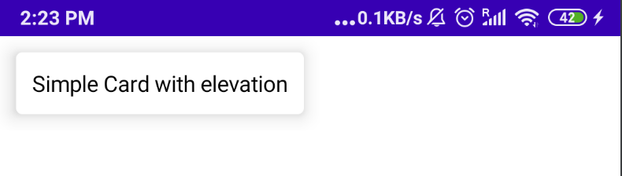
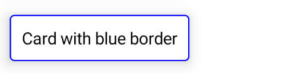
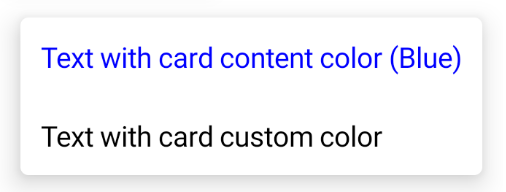

# Card en Jetpack Compose (Material 3)

> Aprende a usar el composable Card de Material 3 en Jetpack Compose: elevación, formas, bordes, varias vistas, colores, tarjetas clicables y las variantes ElevatedCard y OutlinedCard.

*Básicos · 12 de febrero de 2024 · 5 min de lectura*  
*Fuente (en inglés): <https://www.jetpackcompose.net/card-in-jetpack-compose>*

## ¿Qué es Card?

Card es un contenedor que agrupa contenido relacionado sobre un mismo tema. Tiene un contenedor con forma y color propios, puede mostrar elevación (un efecto de sombra) y puede tener un borde con las esquinas redondeadas. 

En Material 3 el contenido de un Card se declara dentro de un `ColumnScope`: los composables que pongas dentro se apilan en vertical, como en una `Column`.

> *Si eres desarrollador de Android (Views):* es un **CardView** (o `MaterialCardView`).

Material 3 ofrece tres tipos de tarjeta, y cada uno tiene una versión normal y otra clicable (con `onClick`):

- `Card`: tarjeta rellena (filled).
- `ElevatedCard`: tarjeta con sombra de elevación.
- `OutlinedCard`: tarjeta con un contorno visible.

## API de Card

Estos son los argumentos de la función `Card` de Material 3 (tarjeta no clicable):

```kotlin
@Composable
fun Card(
    modifier: Modifier = Modifier,                          // Modificadores de tamaño, padding, etc.
    shape: Shape = CardDefaults.shape,                      // Forma del contenedor, del borde y de la sombra
    colors: CardColors = CardDefaults.cardColors(),         // Colores del contenedor y del contenido (activada/desactivada)
    elevation: CardElevation = CardDefaults.cardElevation(), // Elevación en cada estado (reposo, pulsada, etc.)
    border: BorderStroke? = null,                           // Borde alrededor del contenedor (null = sin borde)
    content: @Composable ColumnScope.() -> Unit             // Contenido de la tarjeta, apilado en vertical
)
```

Y esta es la sobrecarga **clicable**, que añade `onClick`, `enabled` e `interactionSource`:

```kotlin
@Composable
fun Card(
    onClick: () -> Unit,                                    // Se ejecuta al pulsar la tarjeta
    modifier: Modifier = Modifier,                          // Modificadores de tamaño, padding, etc.
    enabled: Boolean = true,                                // Si es false, la tarjeta no responde a la pulsación
    shape: Shape = CardDefaults.shape,                      // Forma del contenedor, del borde y de la sombra
    colors: CardColors = CardDefaults.cardColors(),         // Colores del contenedor y del contenido (activada/desactivada)
    elevation: CardElevation = CardDefaults.cardElevation(), // Elevación en cada estado (reposo, pulsada, etc.)
    border: BorderStroke? = null,                           // Borde alrededor del contenedor (null = sin borde)
    interactionSource: MutableInteractionSource? = null,    // Observa interacciones (foco, pulsación...)
    content: @Composable ColumnScope.() -> Unit             // Contenido de la tarjeta, apilado en vertical
)
```

> **Cambios respecto a Material 2:** `backgroundColor` y `contentColor` se agrupan ahora en el parámetro `colors`, y `elevation` ya no es un `Dp` sino un `CardElevation` creado con `CardDefaults.cardElevation(...)`.

## CardDefaults: colores y elevación

`CardDefaults` contiene los valores por defecto de todos los tipos de tarjeta y las funciones para personalizarlos.

```kotlin
// Colores de la tarjeta
CardDefaults.cardColors(
    containerColor: Color = Color.Unspecified,              // Color de fondo de la tarjeta cuando está activada
    contentColor: Color = contentColorFor(containerColor),  // Color del contenido (texto, iconos) cuando está activada
    disabledContainerColor: Color = Color.Unspecified,      // Color de fondo cuando está desactivada
    disabledContentColor: Color = contentColor.copy(DisabledAlpha) // Color del contenido cuando está desactivada
)

// Elevación de la tarjeta en cada estado
CardDefaults.cardElevation(
    defaultElevation: Dp,                                   // Elevación en reposo, sin interacciones
    pressedElevation: Dp,                                   // Elevación cuando se pulsa
    focusedElevation: Dp,                                   // Elevación cuando tiene el foco
    hoveredElevation: Dp,                                   // Elevación cuando el puntero pasa por encima
    draggedElevation: Dp,                                   // Elevación cuando se arrastra
    disabledElevation: Dp                                   // Elevación cuando está desactivada
)
```

> Cada parámetro de `cardElevation` tiene un valor por defecto definido por la especificación de Material 3. Solo tienes que indicar los que quieras cambiar.

## ElevatedCard y OutlinedCard

Estas dos variantes tienen la misma estructura, pero usan valores por defecto distintos:

```kotlin
@Composable
fun ElevatedCard(
    modifier: Modifier = Modifier,                          // Modificadores de tamaño, padding, etc.
    shape: Shape = CardDefaults.elevatedShape,              // Forma del contenedor y de la sombra
    colors: CardColors = CardDefaults.elevatedCardColors(), // Colores propios de la tarjeta elevada
    elevation: CardElevation = CardDefaults.elevatedCardElevation(), // Elevación propia de la tarjeta elevada
    content: @Composable ColumnScope.() -> Unit             // Contenido de la tarjeta, apilado en vertical
)

@Composable
fun OutlinedCard(
    modifier: Modifier = Modifier,                          // Modificadores de tamaño, padding, etc.
    shape: Shape = CardDefaults.outlinedShape,              // Forma del contenedor y del borde
    colors: CardColors = CardDefaults.outlinedCardColors(), // Colores propios de la tarjeta con contorno
    elevation: CardElevation = CardDefaults.outlinedCardElevation(), // Elevación propia de la tarjeta con contorno
    border: BorderStroke = CardDefaults.outlinedCardBorder(), // Borde por defecto de la tarjeta con contorno
    content: @Composable ColumnScope.() -> Unit             // Contenido de la tarjeta, apilado en vertical
)
```

- `ElevatedCard` no tiene parámetro `border`.
- `OutlinedCard` ya trae un borde por defecto, por eso `border` no puede ser `null`.
- Ambas tienen también una sobrecarga clicable con `onClick`, `enabled` e `interactionSource`, igual que `Card`.

**Sintaxis:**

```kotlin
Card {
    AnyComposableFunction()
}
```

> **Imports necesarios:** `androidx.compose.material3.Card`, `CardDefaults`, `ElevatedCard`, `OutlinedCard` y `Text` (todos de `androidx.compose.material3`), y `androidx.compose.foundation.BorderStroke` para los bordes.

## 1. Card con elevación (sombra)

```kotlin
@Composable
fun SimpleCard() {
    val paddingModifier = Modifier.padding(10.dp)
    Card(
        elevation = CardDefaults.cardElevation(defaultElevation = 10.dp),
        modifier = paddingModifier
    ) {
        Text(
            text = "Simple Card with elevation",
            modifier = paddingModifier
        )
    }
}
```

Le damos una elevación de 10.dp en reposo mediante `CardDefaults.cardElevation(defaultElevation = 10.dp)`, así que muestra una sombra de 10.dp. También aplicamos el modificador de padding tanto al Card como al texto.

**Resultado:**



> En Material 3, `elevation = 10.dp` ya no compila: el parámetro espera un `CardElevation`, no un `Dp`. Si lo que buscas es una tarjeta con sombra, también puedes usar `ElevatedCard`.

## 2. Card con forma (shape)

Podemos definir la forma del fondo del Card. Si no se indica ninguna, usará `CardDefaults.shape`, la forma por defecto de las tarjetas en Material 3. Puedes usar las siguientes formas:

- `RectangleShape`
- `CircleShape`
- `RoundedCornerShape`
- `CutCornerShape`
- Las formas del tema, como `MaterialTheme.shapes.large`

```kotlin
@Composable
fun CardWithShape() {
    val paddingModifier = Modifier.padding(10.dp)
    Card(
        shape = RoundedCornerShape(20.dp),
        elevation = CardDefaults.cardElevation(defaultElevation = 10.dp),
        modifier = paddingModifier
    ) {
        Text(text = "Round corner shape", modifier = paddingModifier)
    }
}
```

**Resultado:**


## 3. Card con borde

Usamos la propiedad `border`, para la que hay que indicar un `BorderStroke`. `BorderStroke` tiene dos parámetros: el primero es el grosor del borde y el segundo, su color.

```kotlin
@Composable
fun CardWithBorder() {
    val paddingModifier = Modifier.padding(10.dp)
    Card(
        elevation = CardDefaults.cardElevation(defaultElevation = 10.dp),
        border = BorderStroke(1.dp, Color.Blue),
        modifier = paddingModifier
    ) {
        Text(text = "Card with blue border", modifier = paddingModifier)
    }
}
```

**Resultado:**



> Si quieres una tarjeta con contorno, `OutlinedCard` ya incluye un borde por defecto sin que tengas que indicarlo.

## 4. Varias vistas

En Material 3 el contenido de un Card es un `ColumnScope`, así que puedes colocar varios composables directamente dentro y se apilarán en vertical, sin necesidad de añadir una `Column`. Si quieres otra disposición (por ejemplo, en horizontal), usa `Row` o `ConstraintLayout`.

```kotlin
@Composable
fun CardWithMultipleViews() {
    val paddingModifier = Modifier.padding(10.dp)
    Card(
        elevation = CardDefaults.cardElevation(defaultElevation = 10.dp),
        modifier = paddingModifier
    ) {
        Text(text = "First Text", modifier = paddingModifier)
        Text(text = "Second Text", modifier = paddingModifier)
    }
}
```

**Resultado:**


## 5. Color del contenedor y del contenido (colors)

En Material 3 los colores se indican con el parámetro `colors`, al que se le pasa un `CardColors` creado con `CardDefaults.cardColors(...)`. Con `contentColor` cambiamos el color del contenido de todos los composables hijos que no indiquen uno propio.

```kotlin
@Composable
fun CardWithContentColor() {
    val paddingModifier = Modifier.padding(10.dp)
    Card(
        elevation = CardDefaults.cardElevation(defaultElevation = 10.dp),
        colors = CardDefaults.cardColors(
            containerColor = Color.LightGray,   // Color de fondo de la tarjeta
            contentColor = Color.Blue           // Color del contenido (texto, iconos)
        ),
        modifier = paddingModifier
    ) {
        Text(
            text = "Text with card content color (Blue)",
            modifier = paddingModifier
        )
        Text(
            text = "Text with card custom color",
            color = Color.Black,
            modifier = paddingModifier
        )
    }
}
```

En este ejemplo usamos dos `Text()`. En el primero no indicamos ningún color, así que toma el de **contentColor**. En el otro usamos la propiedad `color`, así que toma el color que se le ha indicado a él mismo.

- `containerColor`: color de fondo de la tarjeta. Sustituye al antiguo `backgroundColor` de Material 2.
- `contentColor`: si no lo indicas, se calcula automáticamente a partir de `containerColor` para que haya buen contraste.
- `disabledContainerColor` y `disabledContentColor`: colores cuando la tarjeta clicable está desactivada (`enabled = false`).

**Resultado:**



## 6. Card clicable

La sobrecarga con `onClick` convierte la tarjeta en un elemento pulsable:

```kotlin
@Composable
fun ClickableCard() {
    Card(
        onClick = { /* Haz algo al pulsar */ },
        modifier = Modifier.padding(10.dp),
        elevation = CardDefaults.cardElevation(
            defaultElevation = 4.dp,    // Elevación en reposo
            pressedElevation = 8.dp     // Elevación mientras se pulsa
        )
    ) {
        Text(text = "Clickable card", modifier = Modifier.padding(10.dp))
    }
}
```

- `onClick`: se ejecuta cuando el usuario pulsa la tarjeta.
- `pressedElevation`: permite que la tarjeta cambie de elevación al pulsarla, para dar sensación de respuesta.
- `enabled = false` desactiva la pulsación y aplica los colores `disabled...` de `CardDefaults.cardColors()`.

## 7. ElevatedCard y OutlinedCard

```kotlin
@Composable
fun ElevatedAndOutlinedCards() {
    Column(modifier = Modifier.padding(10.dp)) {
        ElevatedCard(
            elevation = CardDefaults.elevatedCardElevation(defaultElevation = 6.dp),
            modifier = Modifier.fillMaxWidth()
        ) {
            Text(text = "Elevated card", modifier = Modifier.padding(10.dp))
        }

        Spacer(modifier = Modifier.height(10.dp))

        OutlinedCard(
            border = BorderStroke(1.dp, Color.Blue),
            modifier = Modifier.fillMaxWidth()
        ) {
            Text(text = "Outlined card", modifier = Modifier.padding(10.dp))
        }
    }
}
```

- `ElevatedCard`: usa `CardDefaults.elevatedCardElevation(...)` para ajustar la sombra.
- `OutlinedCard`: ya trae un borde por defecto; aquí lo cambiamos por uno azul con `BorderStroke`.

**Documentación oficial:**

<https://developer.android.com/reference/kotlin/androidx/compose/material3/package-summary#Card(androidx.compose.ui.Modifier,androidx.compose.ui.graphics.Shape,androidx.compose.material3.CardColors,androidx.compose.material3.CardElevation,androidx.compose.foundation.BorderStroke,kotlin.Function1)>
